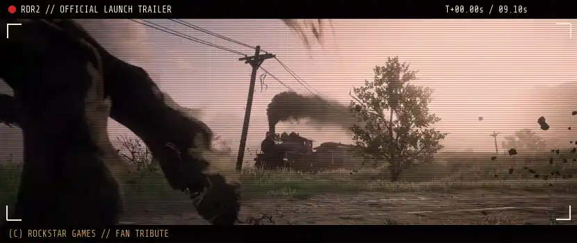
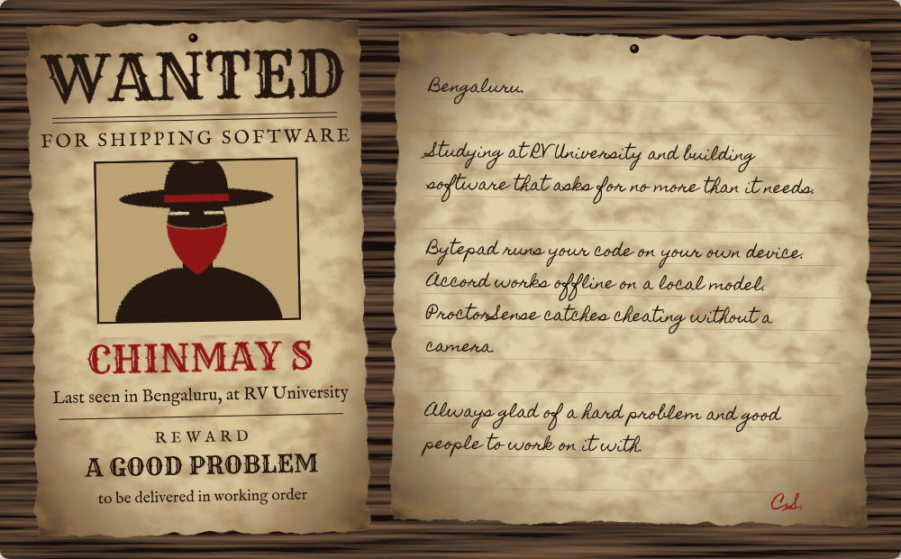
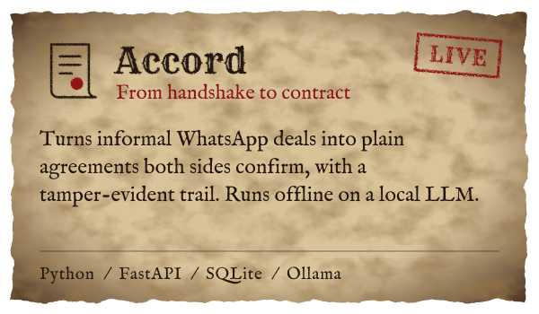

  
  
  
  

Student at RV University in Bengaluru, building private, offline-first software for the web and with local AI.

  
  
  
  

  Live: <a href="https://chinmay6537.github.io/bytepad/">Bytepad</a> &nbsp;/&nbsp;
  <a href="https://accord-zwqk.onrender.com/">Accord</a> &nbsp;/&nbsp;
  <a href="https://overnight-rvce.vercel.app">ProctorSense</a>

Non-commercial fan tribute, not affiliated with or endorsed by Rockstar Games. Red Dead Redemption 2 screenshots and trailer footage are © Rockstar Games, taken from the game's official Steam page. Gallop traced from <i>The Horse in Motion</i> by Eadweard Muybridge (1878, public domain). Headlines set in Chinese Rocks by Typodermic. Generated by <a href="./scripts/build.py">scripts/build.py</a>.

