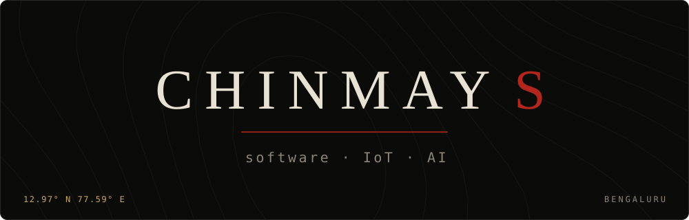
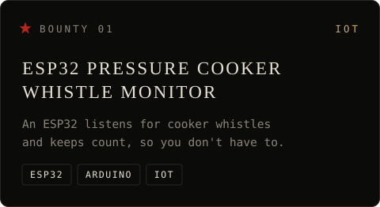
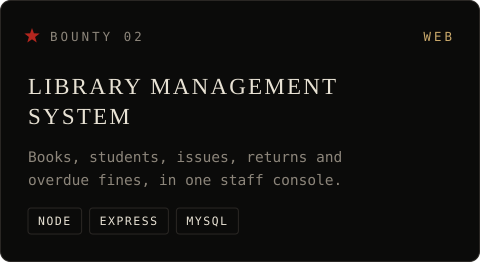
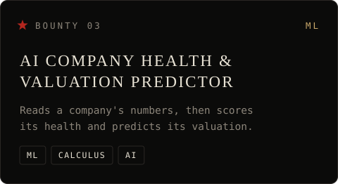
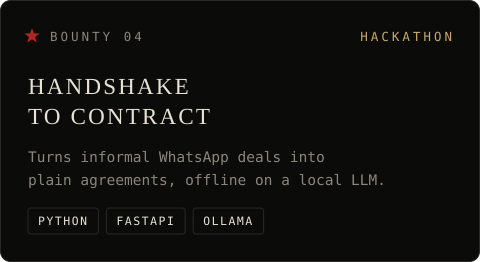

  <picture>
    <source media="(prefers-color-scheme: light)" srcset="https://readme-typing-svg.demolab.com/?font=JetBrains+Mono&amp;size=19&amp;duration=2600&amp;pause=1100&amp;color=0B0B0A&amp;center=true&amp;vCenter=true&amp;width=760&amp;height=56&amp;lines=%3E+name+%E2%86%92+Chinmay;%3E+chapter+%E2%86%92+B.Tech+CSE+%40+RV+University;%3E+riding+toward+%E2%86%92+IoT+%2B+AI+%2B+full-stack;%3E+status+%E2%86%92+building+%26+shipping" />
    
  </picture>

  
  
  <!-- TODO: replace YOUR_EMAIL with the address you want public -->
  
  

 

 

 

 

 

 

<table align="center">
  <tr>
    <td align="center">LANGUAGES</td>
    <td align="center"></td>
  </tr>
  <tr>
    <td align="center">WEB &amp; DATA</td>
    <td align="center"></td>
  </tr>
  <tr>
    <td align="center">TOOLS</td>
    <td align="center"></td>
  </tr>
</table>

 

 

  <!-- TODO: replace # with the repo link -->
  
  
  <!-- TODO: replace # with the repo link -->
  
  

 

 

  
  

  

 

 

  

